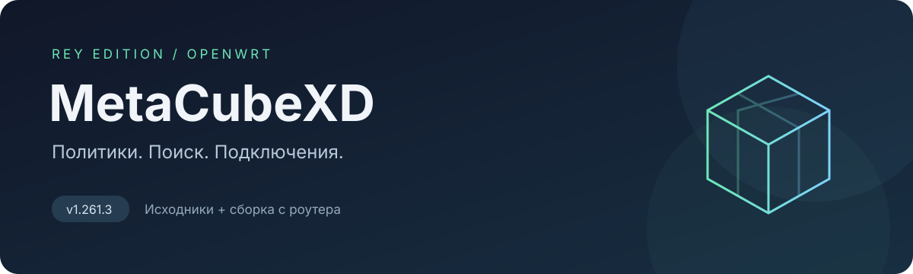

<p align="center">
  
</p>

<p align="center">
  <a href="https://github.com/rey666rey/rey666rey-metacube-xd/actions/workflows/verify.yml"></a>
  
  
  <a href="LICENSE"></a>
</p>

# rey666rey-metacube-xd

**Наша версия MetaCubeXD для Mihomo на OpenWrt.** В репозитории сохранены исходники доработанного интерфейса и статическая сборка, установленная на роутере на **12 ноября 2026 года**.

Главная доработка — удобный выбор подключения внутри каждой политики: собственный поиск, сворачиваемые папки и заметное выделение выбранного узла. Основа — [MetaCubeX/metacubexd](https://github.com/MetaCubeX/metacubexd), версия **1.261.3**. Это самостоятельная пользовательская редакция проекта.

[Готовая сборка](router-ui/) · [Описание доработки](docs/policy-picker.md) · [Происхождение файлов](docs/router-snapshot.md) · [Документация upstream](README.upstream.md)

## Что изменено

| Возможность | Как работает |
| --- | --- |
| Поиск в каждой политике | По имени, стране и провайдеру; понимает флаги и названия стран на русском и английском. |
| Сворачиваемые папки | Подключения организованы по источникам; распознаются BlancVPN, V220, MASTER, DOG и LETO. |
| Группы и агрегаторы | Остаются отдельными доступными для выбора пунктами. |
| Выбранное подключение | Подсвечивается; содержащая его папка отмечается значком. |
| Большие списки | Узлы показываются порциями по 50 с кнопкой загрузки следующей порции. |
| Привычные виды | Сохраняются карточки, списки, таблицы, компактные элементы и двухпанельный режим. |

Поиск и состояние папок запоминаются в пределах открытой страницы отдельно для сервера и политики. Папки существуют в интерфейсе и не изменяют YAML, правила маршрутизации или состав групп Mihomo.

Сохранены возможности базовой панели: переключение прокси, проверка задержки, просмотр подключений, правил, журналов и статистики, темы оформления и русский язык.

## Быстро открыть сохранённую сборку

Нужен Python 3; Node.js для этого не требуется.

```sh
git clone https://github.com/rey666rey/rey666rey-metacube-xd.git
cd rey666rey-metacube-xd
python3 -m http.server 8080 --bind 127.0.0.1 --directory router-ui
```

Откройте [http://127.0.0.1:8080](http://127.0.0.1:8080) и укажите адрес API вашего Mihomo и его ключ. Браузер должен иметь доступ к контроллеру; при отдельном размещении панели контроллер должен разрешать её origin через CORS.

`router-ui/config.js` содержит пустой `defaultBackendURL`. Ключи, подписки и рабочий конфиг роутера в этот репозиторий не входят.

## Что лежит в репозитории

```text
router-ui/         Точная копия статических файлов с роутера + SHA256SUMS
packages/ui/       Vue / Nuxt: интерфейс и наша доработка выбора узлов
packages/agent/    Исходники агента из базового проекта
apps/              Серверная и desktop-версии из базового проекта
docs/              Документация, происхождение сборки и описание изменений
scripts/           Проверка целостности сохранённой сборки
pnpm-lock.yaml     Зафиксированные зависимости исходного проекта
```

Работающая на OpenWrt версия использует **только статическую панель** и уже установленный Mihomo. Наличие исходников агента и desktop-приложения не означает, что эти компоненты установлены на роутере или проверены в этой редакции.

## Разработка и сборка

Требуются Node.js **24** и pnpm **10.34.1**, указанные в `.node-version` и `package.json`.

```sh
pnpm install --filter @metacubexd/ui... --frozen-lockfile
pnpm --filter @metacubexd/ui typecheck
pnpm --filter @metacubexd/ui exec vitest run --exclude='e2e/**'
NUXT_APP_BASE_URL=./ pnpm --filter @metacubexd/ui generate
```

Новая сборка появится в `packages/ui/.output/public/`. Каталог `router-ui/` сохраняет снятый с роутера экземпляр и при сборке автоматически не перезаписывается. Новая генерация может менять имена ресурсов и служебные метаданные; побайтовое совпадение с сохранённой сборкой не гарантируется.

Для разработки с тестовыми данными:

```sh
pnpm --filter @metacubexd/ui dev:mock
```

## Использование на OpenWrt

Mihomo раздаёт файлы панели через параметр `external-ui`. В нашей установке он указывает на `/etc/mihomo/ui`, а панель открывается по `/ui/` на адресе контроллера.

Для переноса готовой версии используются **файлы внутри `router-ui/`**. Перед заменой сохраните прежнюю папку панели. Ресурсы `_nuxt/` и `_fonts/` копируются первыми, HTML и service worker — после них; существующий `config.js` сохраняется, если в нём настроен ваш адрес API. Подробный порядок и восстановление описаны в [документации доработки](docs/policy-picker.md#deployment-and-recovery).

Обновление панели не требует изменения политик, подписок или перезапуска Mihomo. Обновление из upstream может заменить нашу доработку; браузеру или установленной PWA после замены файлов может понадобиться обновление кеша.

## Проверка сохранённой версии

```sh
python3 scripts/verify-router-snapshot.py
```

Проверка сверяет SHA-256 всех файлов сохранённой сборки, её маркер версии и локальные ресурсы стартовых страниц. CI дополнительно выполняет проверку типов и unit-тесты интерфейса. Это не заменяет проверку доступа к вашему API и реальным прокси.

## Благодарности и лицензия

Основа и большая часть кода — [MetaCubeXD от MetaCubeX](https://github.com/MetaCubeX/metacubexd). Оригинальное уведомление об авторских правах сохранено в [LICENSE](LICENSE), лицензия **MIT**. Наша доработка `rey-policy-picker` описана отдельно в [docs/policy-picker.md](docs/policy-picker.md).
